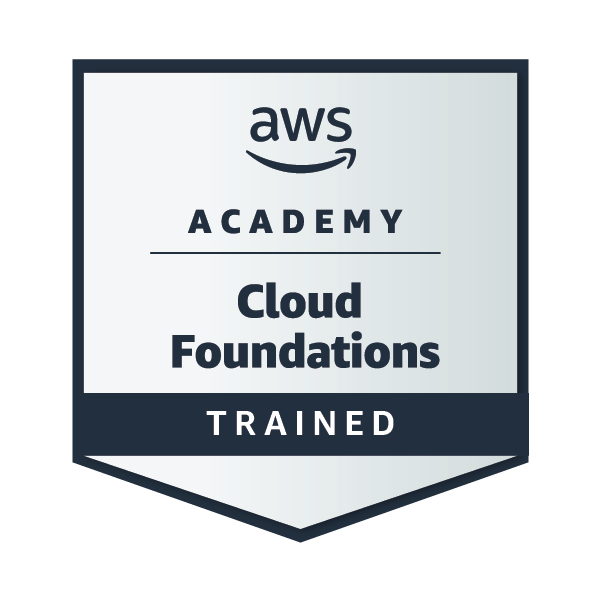
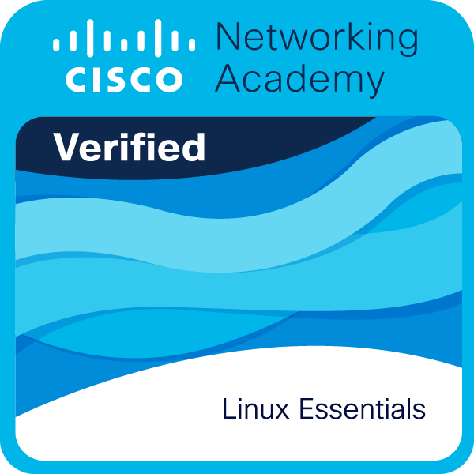

 

  
  

  
  

 

## About Me

I am a Computer Engineering undergraduate at the University of Sri Jayewardenepura, pursuing a minor in Data Management. My interests span intelligent systems, network infrastructure and cloud engineering, with a particular focus on research-driven problem solving.

My work explores reinforcement learning, natural language processing, AI agents, computer vision and cloud-based architectures. I enjoy investigating underlying methods, experimenting with different approaches and translating findings into practical engineering solutions.

I am interested in both research and industry internship opportunities in AI/ML, networking, cloud engineering and software development.

## Research & Engineering Interests

| Research | Engineering |
| :--- | :--- |
| Reinforcement learning & reward design | Network infrastructure & protocols |
| NLP & conversational systems | Cloud & serverless architectures |
| AI agents & retrieval-augmented generation | Backend & distributed systems |
| Computer vision & intelligent perception | Data management & embedded systems |

## Technical Skills

### Programming Languages

### Artificial Intelligence & Machine Learning

### Web, Backend & Databases

### Mobile App Development

### Cloud & Backend Services

### Operating Systems & Development Tools

### Design Tools

### Also Worked With

## Certifications & Digital Badges

  
  &nbsp;&nbsp;&nbsp;&nbsp;
  

 

---

*Curiosity drives research. Engineering turns it into reality.*

